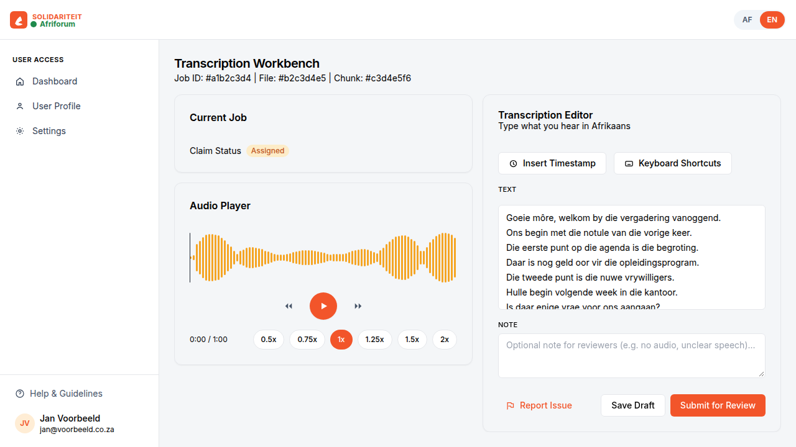
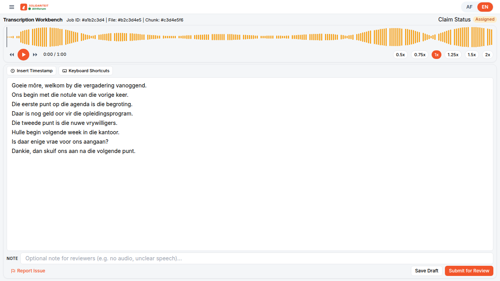
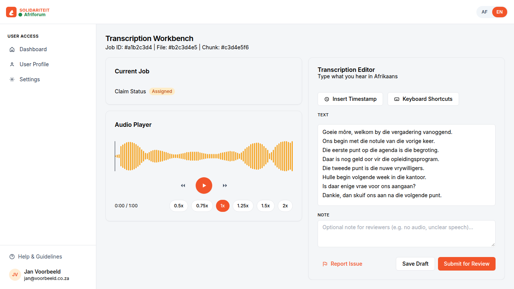
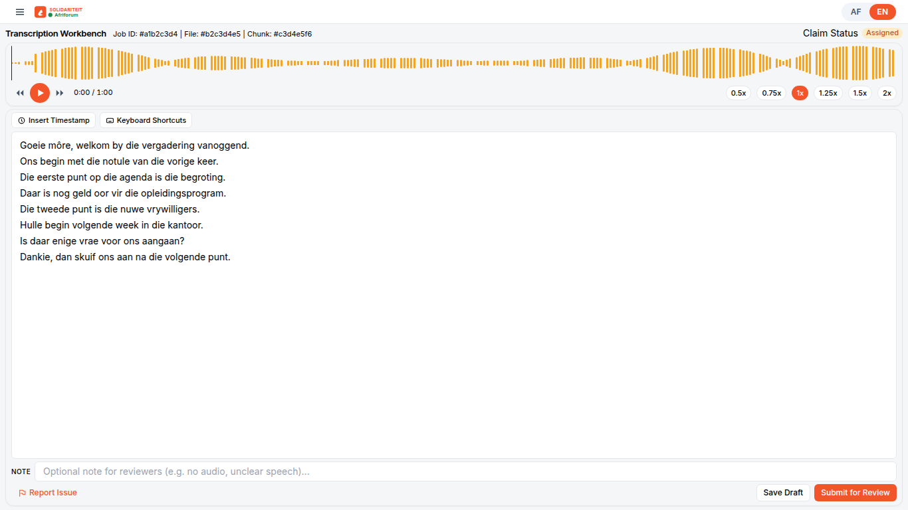
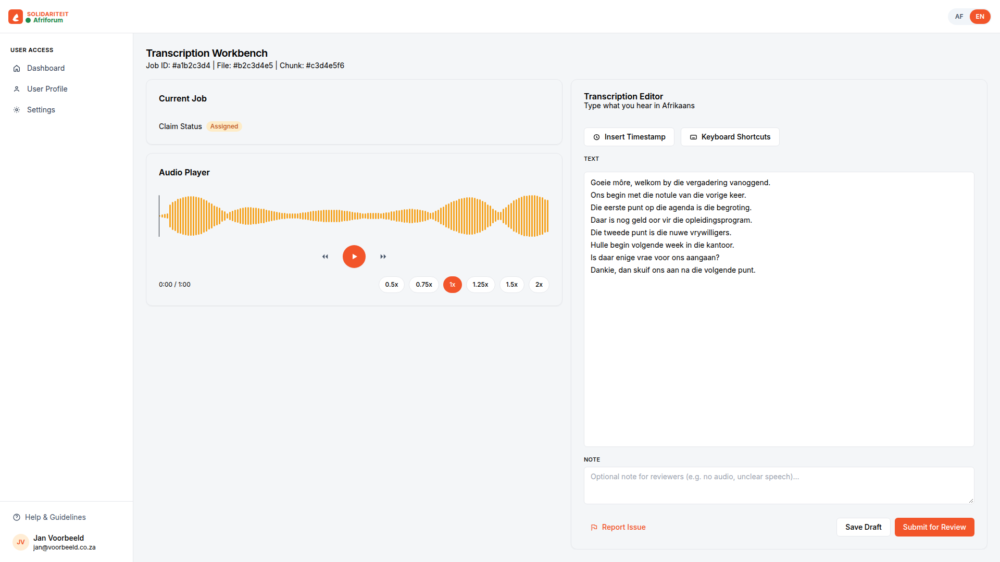
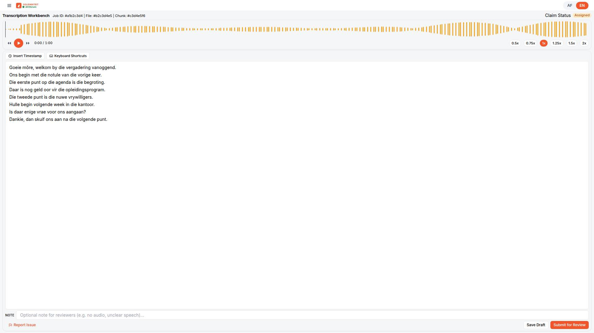

**Afrikaans** | [English](README.en.md)

# Praat.ai kompak werksbank

’n Chrome-uitbreiding wat die [Praat.ai](https://praat.ai)-transkripsie-werkbank kompak maak, sodat dit op ’n klein skootrekenaar pas.

## Hoekom

Praat se werkbank is vir ’n groot skerm gebou. Op ’n skootrekenaar is die teksboks te klein: die kantlys, die kaarte en die klankspeler vat die plek, en jy moet rondskuif om te hoor én te tik.

Hierdie uitbreiding haal weg wat ’n ervare tikker nie nodig het nie. Die kantlys en die groot opskrifte verdwyn, die klankspeler word ’n kort strook, en die teksboks kry die res van die skerm. Jy kan die klank speel en tik sonder om die bladsy te skuif.

Dit verander nie jou woorde nie, en dit dien niks in nie.

## Voor en na

Die foto’s hieronder is van ’n plaaslike nabootsing van die werkbank (dieselfde uitleg as die regte bladsy), voor en ná kompakte modus.

### 1280 × 720

Voor. Die teks word onder in die boks afgesny.



Na. Die teks pas, en die knoppies bly op die skerm.



### 1366 × 768





### 1920 × 1080

Op ’n groot skerm bly die uitleg leesbaar. Die teksboks word net hoër.





## Kenmerke

- Werk net op taakbladsye: `https://praat.ai/job/…`. As Praat binne die bladsy na ’n ander taak gaan, skakel die uitleg steeds aan.
- Die linkerkantlys word versteek. Die werf se eie kieslysknoppie (links bo) maak navigasie oop.
- Groot opskrifte soos “Audio Player” en “Transcription Editor” verdwyn. Die eisstatus bly as ’n kort lyn langs die taaknommer.
- Die golfvorm is kort. Speel, tyd en spoed sit op een ry.
- Die teksboks vul die oorblywende hoogte. Die nota is een lyn. Rapporteer, Stoor en Dien in bly sigbaar.
- Kompakte modus is aan sodra jy die uitbreiding laai. Die ikoon wys ’n klein **ON**.
- Skakel dit af of aan met die uitbreiding se venster, of met **Alt+Shift+C**. Die keuse word onthou.

## Installeer

Jy het nie ’n bou-stap of ’n rekening vir hierdie projek nodig nie.

1. Laai die ZIP af van die [vrystellingsbladsy](https://github.com/GerrieGrotman/praat-ai-kompak-werksbank/releases/latest). Die lêer heet `praat-ai-kompak-werksbank-1.0.1-cws.zip`.
2. Pak dit uit. Kies die vouer waarin `manifest.json` direk lê.
3. Maak Chrome oop. Tik `chrome://extensions` in die adresbalk en druk Enter.
4. Skakel **Developer mode** aan. Dit is die skakelaar regs bo. In Afrikaanse Chrome staan dit **Ontwikkelaarmodus**.
5. Klik **Load unpacked**. In Afrikaanse Chrome: **Laai uitgepak**.
6. Kies die vouer waarin `manifest.json` direk lê. In hierdie bronkode is dit `praat-ai-kompak-werksbank`.
7. Maak ’n transkripsietaak oop: `https://praat.ai/job/…`

Die bladsy behoort dadelik kompak te lyk.

As jy eerder die hele bronkode aflaai (Code → Download ZIP op GitHub), pak dit uit en kies die *binne*-vouer `praat-ai-kompak-werksbank`.

Speld dit vas sodat jy dit maklik kry: klik die legkaartstukkie in Chrome, en dan die pennetjie langs **Praat.ai kompak werksbank**.

Dieselfde stappe staan in `praat-ai-kompak-werksbank/INSTALL.txt`, binne-in die vouer wat jy laai.

## Gebruik

- Klik die uitbreiding se ikoon en gebruik die skakelaar om kompakte modus af of aan te sit.
- Of, terwyl ’n taak oop is, druk **Alt+Shift+C**.
- As die kortpad die eerste keer niks doen nie, gaan na `chrome://extensions/shortcuts`. Soek **Toggle compact transcription layout** en stel dit op Alt+Shift+C.

Ander Praat-bladsye, soos die paneelbord, bly soos hulle is. As jy van die paneelbord na ’n taak gaan sonder om die hele bladsy te herlaai, skakel die kompakte uitleg steeds aan.

## Hoe dit werk, en perke

Die uitbreiding loop net op `https://praat.ai/job/*`. Dit verander net die uitleg op jou skerm. Dit lees nie jou teks om dit weg te stuur nie, en dit klik nie Stoor of Dien in nie. Praat se eie knoppies, kortpaaie en speelknoppie bly werk.

Praat kan later sy bladsy verander. As iets skeef lyk, skakel kompakte modus af en herlaai die bladsy. ’n Nuwe weergawe van die uitbreiding is dalk nodig. Kyk na [CHANGELOG.md](CHANGELOG.md).

Die golfvorm word deur Praat se eie speler geteken. Kompakte modus maak net die buitekant 52 piksel hoog en skaal die tekening sodat die stawe sigbaar bly.

## Ontwikkeling en toets

Daar is geen bou-stap nie. Laai die vouer `praat-ai-kompak-werksbank` in Chrome soos hierbo.

Die regte werf vra ’n rekening, daarom boots `test/mock-job.html` die bladsy na, met WaveSurfer vir die golfvorm. Vanuit hierdie projekvouer:

```bash
python3 -m http.server 8741
```

Maak [die nagemaakte taak](http://127.0.0.1:8741/test/mock-job.html) oop. Voeg `?compact=0` by die adres om die oorspronklike spasiëring te sien. Alt+Shift+C wissel die uitleg. Die voorskou laai nie klank op nie en dien niks in nie.

Om die uitleg outomaties te meet, het jy Chrome en Node nodig:

```bash
cd test
npm install
node verify.mjs
```

Dit kyk na 1280×720, 1366×768 en 1920×1080: geen bladsyskuif nie, ’n groot teksboks, en ’n golfvorm waarvan die stawe sigbaar bly.

| Lêer | Wat dit is |
| --- | --- |
| `praat-ai-kompak-werksbank/` | Die uitbreiding. Laai hierdie vouer in Chrome. |
| `praat-ai-kompak-werksbank/content.css` | Die kompakte uitleg. |
| `praat-ai-kompak-werksbank/content.js` | Skakel die uitleg aan op `/job/`-bladsye en volg Praat se bladsywissels. |
| `praat-ai-kompak-werksbank/popup.html` | Die aan/af-skakelaar. |
| `test/mock-job.html` | ’n Nabootsing van die taakbladsy. |
| `test/verify.mjs` | Meet die nabootsing. |
| `docs/` | Voor-en-na-foto’s. |

Die keuse word in `chrome.storage` gehou, en ook in die bladsy se `localStorage` onder `praat-compact-enabled`, sodat die uitleg reeds reg is wanneer die taak oopmaak.

## Lisensie

MIT. Sien [LICENSE](LICENSE).

## Privaatheid

Die uitbreiding versamel geen persoonlike data nie. Die aan/af-keuse bly net op hierdie rekenaar. Sien [PRIVACY.md](PRIVACY.md).

## Vrywaring

Dit is ’n nie-amptelike projek. Dit is nie aan Praat, Solidariteit of AfriForum verbonde nie, en word nie deur hulle gemaak of onderskryf nie.
